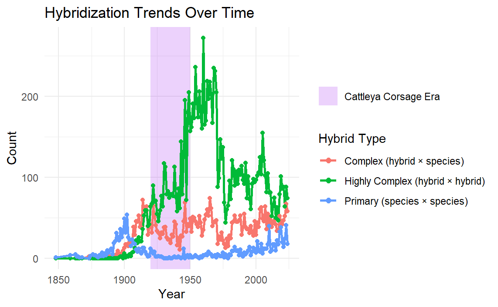
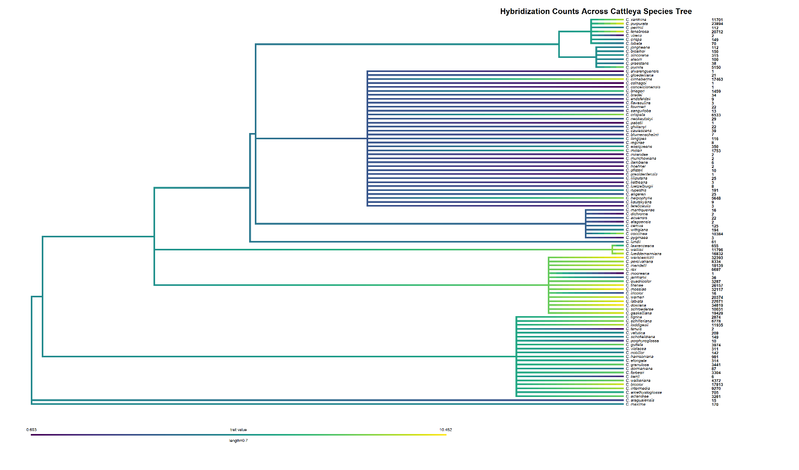

# _Cattleya_ Hybridization: Trends Over Time and Phylogenetic Signal

Course project (bioinformatics), May 2025, by Jaret Arnold. The full write-up is in
[writeup.md](writeup.md).

The Royal Horticultural Society has registered orchid hybrids since the mid-19th century, which
makes _Cattleya_ a long record of deliberate hybridization. Using that register as republished on
[orchidroots.com](https://www.orchidroots.com/), this project asks how hybridization and hybrid
complexity have changed over time, and whether the number of hybrids a species has produced is
clustered on the _Cattleya_ phylogeny.

## Results

Hybridization and complexity both rose and then partly reversed. Early crosses were mostly primary
(species × species). By the mid-20th century, crosses of hybrid with hybrid dominated, peaking
during the _Cattleya_ corsage era and falling as corsages went out of fashion. The three classes are
closer to balanced today. Mean ancestors per hybrid rose from about 2 in the 1850s to about 22 by
the 1970s, and has stayed between about 21 and 24 since.

<p align="center"></p>

Hybrid counts are phylogenetically clustered, but only the species-level tree detects it. On the
subgeneric-rank tree no statistic was significant. With species attached as polytomies within their
Van den Berg (2014) subgeneric ranks and Grafen branch lengths, three of the four tests were
significant:

| Tree                 | Blomberg's K    | Pagel's λ         | Moran's I        | Abouheif's C<sub>mean</sub> |
| -------------------- | --------------- | ----------------- | ---------------- | --------------------------- |
| Subgeneric rank tree | 0.768 (p=0.405) | ~0.00004 (p=1)    | −0.105 (p=0.478) | −0.095 (p=0.338)            |
| Species level tree   | 0.184 (p=0.339) | 0.305 (p=2.2e−06) | 0.13 (p=0.001)   | 0.32 (p=0.001)              |

Blomberg's K was not significant on either tree. The species tree is largely polytomous, and K
depends on branch-length structure that Grafen scaling only approximates.

<p align="center"></p>

## Reproducing

Everything runs from the derived tables in `data/`:

```r
# from analysis/
Rscript figures_from_derived.R    # Figures 1, 2, S1, S2   (ggplot2, dplyr)
Rscript species_tree_signal.R     # Figure 3 and Table 1   (ape, phytools, phylosignal, phylobase, viridis)
```

Output goes to `figures_regenerated/`. The subgeneric row regenerates exactly, apart from
permutation p-values. The species-level row comes out close to the published values, with all four
conclusions unchanged (K 0.210 vs 0.184, λ 0.337 vs 0.305, Moran's I 0.120 vs 0.13,
C<sub>mean</sub> 0.323 vs 0.32). C<sub>mean</sub> ignores branch lengths and matches, so the
species set and topology are the same as in the original run; the small differences come from
branch lengths.

`derive_tables.R` built the tables in `data/` from the raw records and is included for reference;
the raw records are not distributed (see [data/README.md](data/README.md)).

## Data

The records were collected from orchidroots.com on 12 March 2025. After cleaning they cover 18,739
registered hybrids (18,718 with a registration year) and 100 species with a subgeneric rank. `data/`
holds only aggregates: counts by year and type, ancestor counts by year, and per-species hybrid
counts. It contains no grex names, parentage, registrants or links.

## License

Text and figures © 2025 Jaret Arnold. Code is under the MIT License ([LICENSE](LICENSE)).
