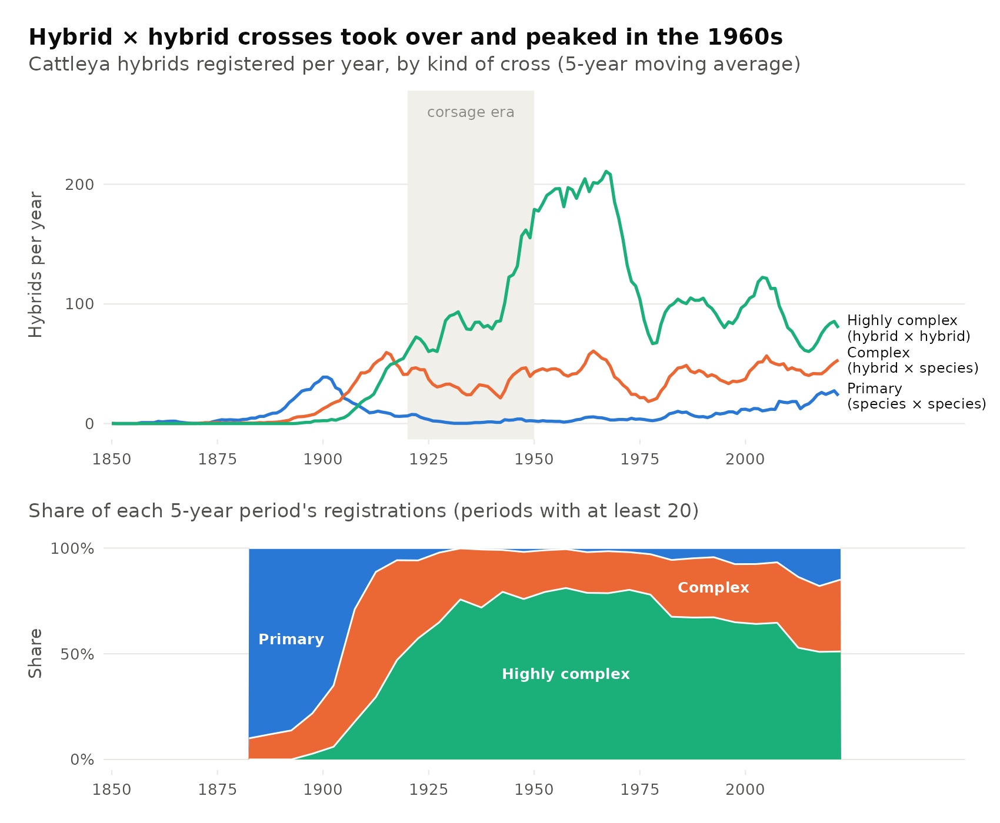
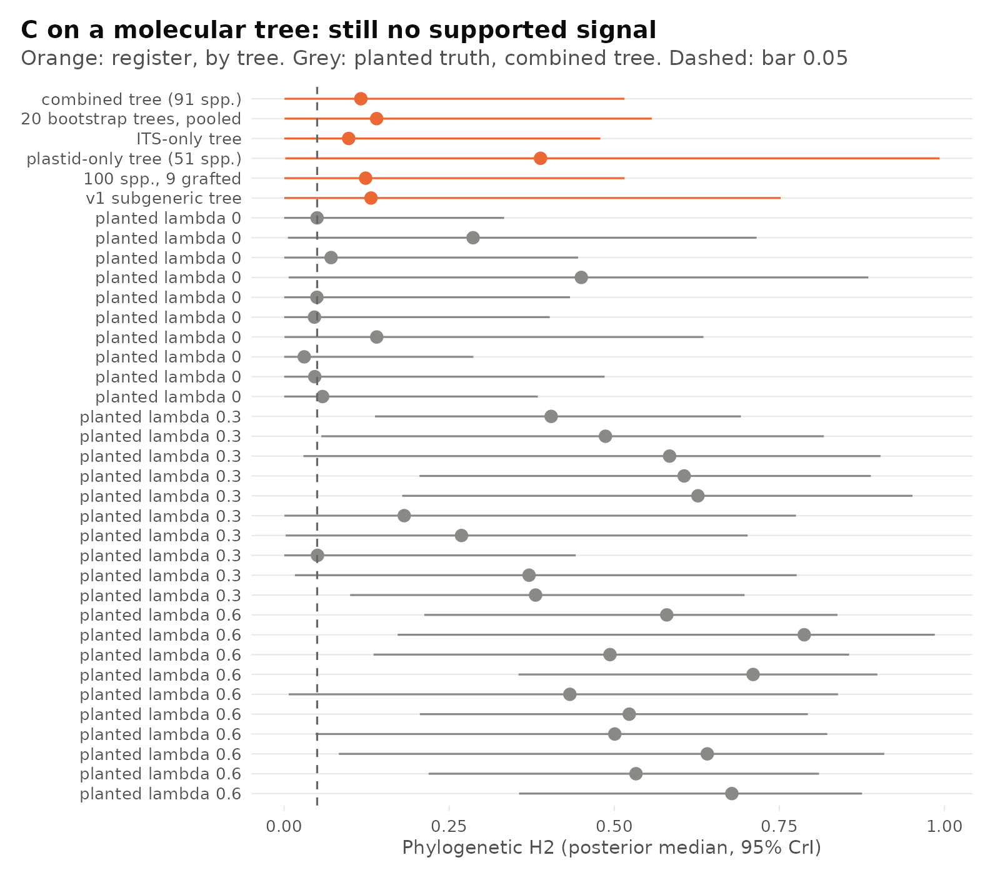
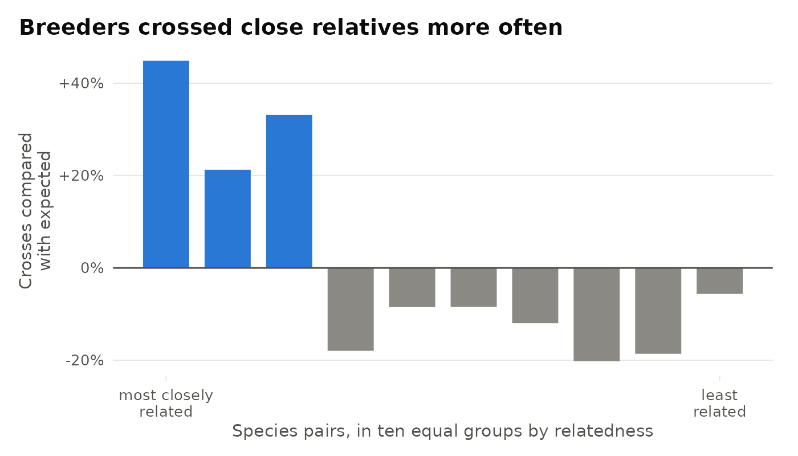
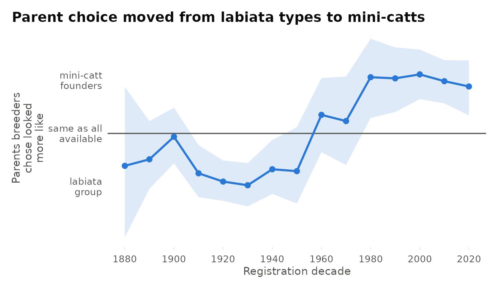

# _Cattleya_ Hybridization: Trends Over Time and Phylogenetic Signal

Course project (bioinformatics), May 2025, by Jaret Arnold. The full write-up is in
[writeup.md](writeup.md).

The Royal Horticultural Society has registered orchid hybrids since the mid-19th century, which
makes _Cattleya_ a long record of deliberate hybridization. Using that register as republished on
[orchidroots.com](https://www.orchidroots.com/), this project asks how hybridization and hybrid
complexity have changed over time, and whether the number of hybrids a species has produced is
clustered on the _Cattleya_ phylogeny.

## Results

Hybridization and complexity both rose and then partly reversed. Early crosses were mostly primary
(species × species). Crosses of hybrid with hybrid rose through the _Cattleya_ corsage era,
peaked around 1960, then fell steeply. The three classes are closer to balanced today, though primary
crosses are still the fewest. Mean ancestors per hybrid rose from about 2 in the 1850s to about 22 by
the 1970s, and has stayed between about 21 and 24 since.

<p align="center"></p>

The write-up also reported that hybrid counts cluster on the phylogeny. That result is withdrawn
([CORRECTIONS.md](CORRECTIONS.md#phylogenetic-signal)). It scored each species by all its registered
descendants, intergeneric ones included, with no control for how long the species had been available
to breeders. On the polytomous species tree it used, Pagel's λ was significant in 200 of 200
simulated data sets that had no signal. The original numbers were:

| Tree                 | Blomberg's K    | Pagel's λ         | Moran's I        | Abouheif's C<sub>mean</sub> |
| -------------------- | --------------- | ----------------- | ---------------- | --------------------------- |
| Subgeneric rank tree | 0.768 (p=0.405) | ~0.00004 (p=1)    | −0.105 (p=0.478) | −0.095 (p=0.338)            |
| Species level tree   | 0.184 (p=0.339) | 0.305 (p=2.2e−06) | 0.13 (p=0.001)   | 0.32 (p=0.001)              |

A pre-registered re-test counts primary hybrids per species, with years since the species was first
described as exposure and a phylogenetic random effect. On a molecular tree built from GenBank ITS,
matK and trnL-F sequences for 91 species, the phylogenetic share of variation is 0.12 (95% interval
0.0005–0.52), short of the pre-registered bar. The same test finds planted strong signal in 8 of 10
simulated data sets and false signal in none of 10, so strong clustering is unlikely rather than
just undetected. At weak signal (λ 0.3) it detected it in 5 of 10 simulations, so weak
clustering can neither be shown nor ruled out with these data.

<p align="center"></p>

Two later analyses found clear patterns. Breeders crossed close relatives more often: each standard
deviation of phylogenetic distance between two species cuts their expected number of primary hybrids
by 17% (rate ratio 0.83, 0.77–0.89, 88 species), mostly from 1960 on (0.74, against 0.96 before).
"Expected" allows for how popular each species was and how long both were known.

<p align="center"></p>

In image embeddings of photos of 2,877 grexes, the change in flower appearance came from which parents
breeders chose, not from offspring departing from their parents: toward the labiata group from the 1910s
to the 1940s, and toward the mini-catt founders from the 1980s on. The shaded band is the 95% interval;
a second image model gives the same picture.

<p align="center"></p>

These, along with founder species by decade, natural against registered hybrids, three unresolved
tests and register quality checks, are in [docs/v2_deeper.md](docs/v2_deeper.md).

## Reproducing

Everything runs from the derived tables in `data/`:

```r
# from analysis/
Rscript figures_from_derived.R    # Figures 1, 2, S1, S2   (ggplot2, dplyr, tidyr, patchwork, ragg)
Rscript species_tree_signal.R     # Figure 3 and Table 1   (ape, phytools, phylosignal, phylobase, ggplot2, patchwork, ragg)
C_TREE=../data/molecular_combined.nwk C_TAG=mol_e5 Rscript signal_corrected.R real   # corrected test (brms)
Rscript readme_figures.R          # the two later-analysis figures above (ggplot2, jsonlite)
```

Output goes to `figures_regenerated/`. The subgeneric row regenerates exactly, apart from
permutation p-values. The species-level row comes out close to the published values, though the
conclusion drawn from them is withdrawn (K 0.210 vs 0.184, λ 0.337 vs 0.305, Moran's I 0.120 vs 0.13,
C<sub>mean</sub> 0.323 vs 0.32). C<sub>mean</sub> ignores branch lengths and matches, so the
species set and topology are the same as in the original run; the small differences come from
branch lengths.

`derive_tables.R` built the tables in `data/` from the raw records and is included for reference;
the raw records are not distributed (see [data/README.md](data/README.md)).

## Data

The records were collected from orchidroots.com on 12 March 2025. After cleaning they cover 18,739
registered hybrids (18,718 with a registration year) and 100 species with a subgeneric rank. `data/`
holds only aggregates: counts by year and type, ancestor counts by year, and per-species hybrid
counts, plus the later analyses' per-species, per-pair and per-decade tables, molecular trees and
result files. It contains no grex names, parentage, registrants or links. See
[data/README.md](data/README.md).

The appearance analysis also used one photo per grex and per parent species, downloaded slowly from
OrchidRoots in October–November 2026. The photos and their image embeddings are not distributed.

## License

Text and figures © 2025 Jaret Arnold. Code is under the MIT License ([LICENSE](LICENSE)).
