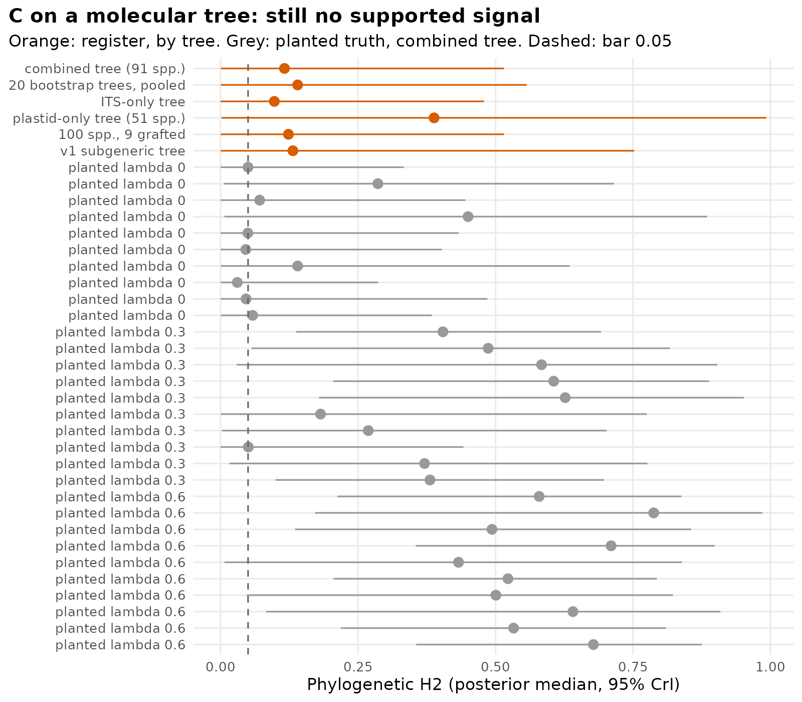
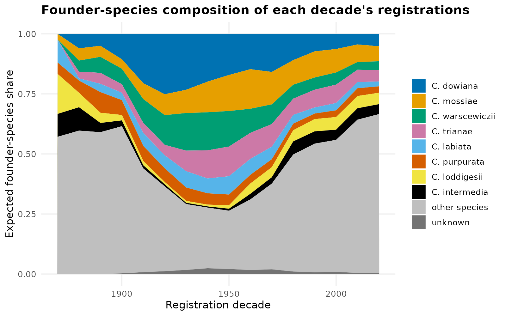
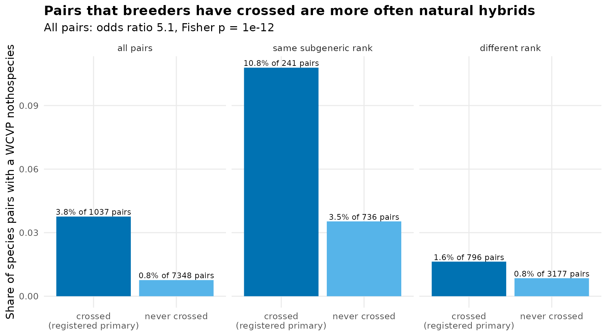
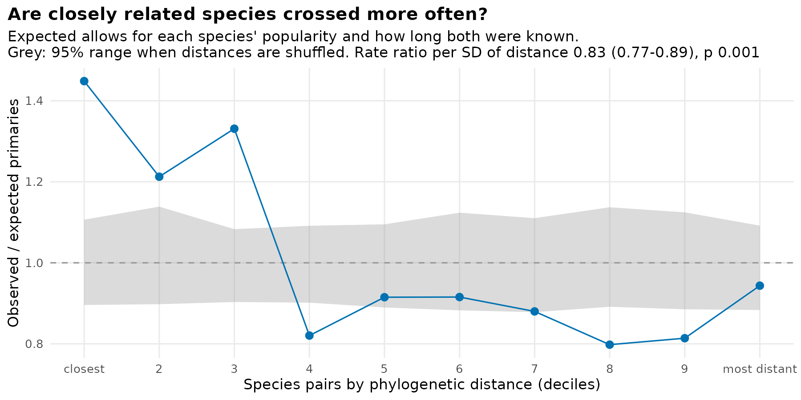
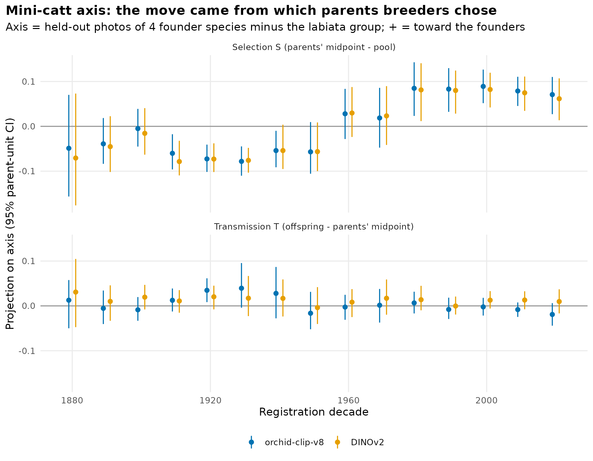
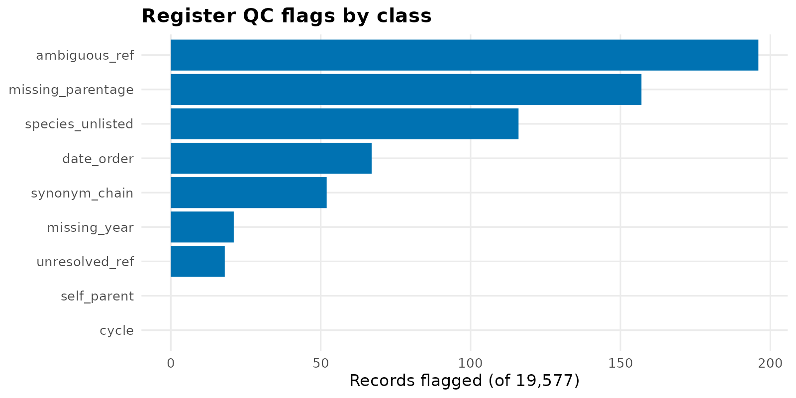

# v2 additions: going deeper into the Cattleya register

Every test below was written down before its real numbers were computed (`analysis/prereg/`), and was run first on simulated registers with a known answer. Figures are in `figures/deeper/`. Rebuild them into `figures_regenerated/deeper/` with `Rscript figures_deeper.R G A E sims C`, run from `analysis/`. The U–Y figures come from their own scripts (`*_readout.R`, `Y_figures.R`).

## Phylogenetic signal, corrected (C)
v1's signal result is withdrawn (see `CORRECTIONS.md`). v1 scored species by total descendants and fit a Gaussian λ. On this tree λ rejected in 200 of 200 simulated data sets with no signal, and a placebo trait (years since description) scores higher than the hybrid counts. The corrected test models primary-hybrid counts as Poisson, with years since first description as exposure. On the v1 tree it gives a phylogenetic share of 0.13 with a 95% interval of 0.0003–0.75: no signal and strong signal fit about equally well.

That tree is mostly unresolved, so the test was re-run on a molecular tree built from GenBank ITS, matK and trnL-F for 91 species. The answer holds and gets sharper: 0.12 (0.0005–0.52). It is the same on 20 bootstrap trees, on ITS-only and plastid-only trees, and with all 100 species. On this tree the test catches strong signal 8 times in 10 and false signal 0 times in 10, so strong clustering is unlikely rather than just undetected. At weak signal (λ 0.3) it detects it in 5 of 10 simulations, so weak clustering can neither be shown nor ruled out with these data. Species moved into *Cattleya* from *Laelia* and related genera have about as many primaries per year as the rest (rate ratio 0.69, 0.47–1.03). An earlier draft reported 2.0–2.5 times as many; that came from dating their exposure from their current name (2006–2014) rather than their first description (Amendment 5).

## Founder species (A)

The founder mix of each decade's registrations narrowed from about 26 effective founder species around 1900 to about 9 in the 1920s–1950s. By the 1930s–1950s the labiata group (labiata, mossiae, trianae, warscewiczii, dowiana) supplied two thirds of the ancestry. The mix widened again after 1960 as the mini-catt founders came in (coccinea, walkeriana, aclandiae, intermedia: 1% of 1950s ancestry, 16% of 1980s ancestry). The walk agrees with OrchidRoots' own ancestry figures (median difference 0.001 over 238 grexes).

The pre-registered bottleneck test found nothing: the effective number of ancestors equals the effective number of founder species in every decade. With about a hundred founder species, no single grex outweighs a species.

One pattern was not pre-registered. Founder diversity sits below what random re-pairing of the same parents gives in every decade from 1890 on, and at about half of it in 1910–1970 (`A_null_f_e.png`). That points to breeders crossing within lineages rather than to the reuse of a few parents. It is held as the confirmatory test for the rerun on the OrchidRoots Research Data List.

## Natural vs registered hybrids (E gate)

Species pairs that breeders have crossed are five times as likely to have a natural hybrid (WCVP nothospecies) as pairs never crossed: 3.8% vs 0.8%, Fisher p ≈ 1e-12. The full model, which would split isolation into its before-mating and after-mating parts, was not built. It needs the register to show a man-made cross for nearly every natural hybrid. It shows one for 41% (`E_readout1_breakdown.png`). Most of the rest appear only as the natural hybrid itself, or as a remake filed under its name.

## Which species pairs breeders crossed (W)

Breeders crossed close relatives more often. Across 88 species, each standard deviation of phylogenetic distance between two species cuts their expected number of primary hybrids by 17% (rate ratio 0.83, 0.77–0.89; permutation p 0.001). This holds without pairs that also form natural hybrids (0.85), on an ITS-only tree (0.83) and on 20 bootstrap trees (0.82–0.84). It is a post-1960 pattern: before 1960 the ratio is 0.96, from 1960 on 0.74 (p 0.001). The figure looks like a step rather than a slope: the closest three tenths of pairs were crossed 1.2–1.45 times as often as expected, the rest 0.8–0.95 times (descriptive, not tested). The register records only registered crosses, so "never crossed" mixes untried with failed.

## How the flowers changed (Y)

One photo each of 2,877 grexes and 116 parent species, downloaded slowly from OrchidRoots and not redistributed, was turned into image embeddings with two models (orchid-clip-v8 and DINOv2). Both place a primary hybrid nearer its own parents than a random species pair (AUC 0.91 and 0.82, 522 primaries). For each decade, the change in look was split into selection (how the parents breeders chose differed from everything available) and transmission (how the offspring differed from their parents' average).

On the axis from the labiata group to the four mini-catt founders, the two models agree in every decade. From the 1910s to the 1940s breeders chose parents on the labiata side of what was available; in the 1960s–70s, neither side; from the 1980s on, the mini-catt side. Offspring stayed close to their parents' average throughout. The change came from which parents were chosen.

The decade path is a loop, not a line (`Y_decade_path_v8.png`): out to the 1910s–20s, a turn in the 1950s, a new region from the 1960s. So the pre-registered main axis, the first principal component of the decade averages, points opposite ways in the two models, and its decade labels disagree in 13 of 15 decades. Those labels are not used. The method was changed twice before any real photo was analysed (amendments 1 and 2 in `analysis/prereg/Y_appearance_over_time.md`), after random vectors passed the original version.

## Not resolved (U, V, X)
- **Why some species were used more (U):** range size has no strong effect on how often a species became a parent (rate ratio 1.13, 0.96–1.36). Brazilian origin, wet habitat and growing on rock could not be tested with enough power (`U_species_use.png`).
- **The post-1960 shift in species use (V):** whether the shift follows the phylogeny could not be shown (phylogenetic share 0.78, 0.008–1.00; the test finds planted signal 6 times in 10). The labiata group lost use and the rock-dwelling Brazilian laelias gained it (`V_era_shift.png`).
- **Breeders copying breeders (X):** breeders whose network had already used a mini-catt founder were not clearly quicker to start (odds ratio 1.47, 0.83–2.59). The test catches an odds ratio of 1.5 only 3 times in 10 (`X_breeder_diffusion.png`).

## Closed by their power simulations (B, D)
- **Mericloning and generation interval (B):** a smooth upward curve in parent age produces a false "1960 break" in up to 30% of simulated registers (`B_sim_power.png`). The real statistic was not opened.
- **Fertility by rank class (D):** the register can detect a halving of the odds of reuse across subgeneric ranks, but not a 30% drop (power 0.77 against a 0.80 bar; `D_sim_power.png`). The real statistic was not opened.

## Register QC (G)

The report for OrchidRoots (local, not sent) lists 67 parent-registered-after-child records (the "141" in earlier notes was a parsing artefact), 196 references to names that more than one grex carries, and 157 records without parentage. There are no pedigree cycles. Flag precision has not yet been checked by a curator.
